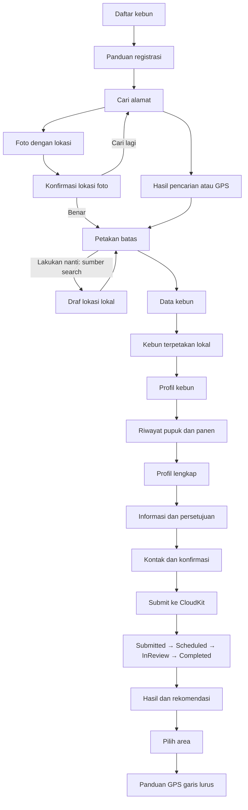

# Kajian arsitektur Palm Oil Farmer

Tanggal: 4 November 2026. Status: usulan untuk dibahas, belum diimplementasikan.

## Keputusan yang disarankan

Gunakan **Clean Architecture dengan MVVM-C ringan, dirender oleh SwiftUI NavigationStack**. Mulai dengan pemisahan koordinasi di app dan flow registrasi; jangan membuat coordinator untuk setiap layar. Gunakan route bertipe dan ID, serta dependency injection melalui initializer.

NavigationStack adalah API navigasi; Coordinator adalah pemilik kebijakan perpindahan layar. Keduanya dapat dipakai bersama. Perbandingan yang bermakna ialah MVVM dengan navigasi dikelola View/feature host versus MVVM dengan objek coordinator yang mengelola transisi lintas layar.

Alasan utama memilih coordinator pada project ini adalah flow registrasi yang berpindah antara sheet, photo picker, full-screen map, dan sheet detail. ContentView saat ini sudah menjalankan pekerjaan coordinator secara implisit. Clean Architecture sendiri tetap membutuhkan pemisahan use case dan repository, apa pun pilihan navigasinya.

## Cakupan dan batas bukti

- Kajian berasal dari app entry point, layar fitur, model, persistence SwiftData, adapter CloudKit, layanan lokasi, fixture, README, konfigurasi project, dan tiga berkas pengujian.
- Implementasi menjadi acuan ketika README berbeda dengan kode. Bagian user-testing README masih menyebut JSON dan belum ada review service, sedangkan implementasi sudah memakai SwiftData dan CloudKit.
- Kebutuhan di bawah dibedakan menjadi perilaku yang sudah ada, kekurangan implementasi, dan usulan. Belum ada spesifikasi stakeholder terpisah yang dipakai dalam kajian ini.
- Pressure test di sini adalah evaluasi desain berbasis skenario kegagalan. Ini bukan benchmark, eksekusi dua prototype, atau pengujian simulator.
- Unit test/build tidak dijalankan: `xcodebuild -version` gagal karena active developer directory menunjuk CommandLineTools. Tidak ada perubahan source aplikasi dalam kajian ini.

## Produk dan flow yang berjalan

App ini membantu petani mendaftarkan kebun, melengkapi konteks agronomi, meminta peninjauan/drone, membaca hasil dan alokasi pupuk, lalu menemukan area di lapangan. Implementasi operator dan pembentukan analisis agronomi tidak ada di repo ini.



Detail perilaku yang perlu dipertahankan:

1. Home menyatukan draf lokasi, kebun lokal, dan kebun yang sudah diajukan. Filter dapat ditampilkan melalui pengaturan developer.
2. Registrasi membuka guide lalu pencarian dalam sheet. Pilihan lokasi menutup sheet sebelum full-screen mapping muncul. Foto mempunyai tahap konfirmasi dan jalan kembali ke pencarian.
3. Draf “Lakukan Nanti” hanya menyimpan lokasi; batas yang sedang digambar belum menjadi draf persisten. Opsi ini saat ini dibatasi untuk lokasi dengan source `.search`.
4. Mapping menambah dan menggeser titik batas. Simpan dilanjutkan ke nama kebun, tahun/bulan tanam, dan jenis tanah. Batas invalid menghalangi kelanjutan dari editor, tetapi penyimpanan store sendiri belum menegakkan validasi batas.
5. Riwayat pupuk dan panen diedit melalui draft lokal editor. Profil dinilai lengkap jika ada minimal satu catatan pupuk dan satu catatan panen (`Garden.isProfileComplete`). Ini perilaku saat ini, belum tentu aturan agronomi final.
6. Review berisi persetujuan program, kontak, dan konfirmasi kebenaran kontak. Setelah server menyimpan permintaan, store menghapus draf lokal dan membuat garden dari hasil server.
7. Status diperoleh lewat refresh daftar atau fetch saat profil dibuka. API polling 5 detik ada, tetapi tidak ditemukan pemanggil dari UI.
8. Hasil nyata diadaptasi dari CloudKit; masih ada fallback `DemoReviewReport` untuk status completed tanpa report. Download hasil pada layar status masih simulasi 8 detik.
9. Rekomendasi berisi kebutuhan pupuk, estimasi biaya, alokasi area, dan tab curah hujan. Data hujan bisa kosong pada hasil nyata. Panduan area memakai GPS dan jarak langsung, bukan rute jalan.
10. `FindingWaypointView` adalah entry point eksperimen, bukan root app. Geometri dan session GPS dari folder tersebut dipakai oleh flow hasil.

## Kepemilikan data saat ini

| Data | Penyimpanan saat ini | Konsekuensi |
| --- | --- | --- |
| Lokasi belum dipetakan | SwiftData `DraftPlantationRequest`, `isBoundaryMapped = false` | Bisa dilanjutkan setelah app dibuka kembali |
| Kebun terpetakan belum diajukan | SwiftData model yang sama, `isBoundaryMapped = true` | Riwayat dan data kebun lokal persisten |
| Kebun sudah diajukan | CloudKit public database; proyeksi Garden di memori | Tidak ada cache persisten untuk startup offline setelah draf dihapus |
| Status aktif profil | Garden.review ditambah state activeReviewStatus/entries/report | Beberapa salinan status bisa berbeda |
| Penanda hasil diunduh | Flag GardenReview; mapper menganggap completed sudah downloaded | Belum mencerminkan keberadaan berkas lokal |
| Area demo | Dihitung ulang dari boundary menjadi enam zona | Bukan hasil segmentasi agronomi server |
| Area hasil nyata | DTO berisi ID dan dosis; adapter belum mengisi `zone` | Belum ada geometri tujuan untuk navigasi area nyata |

Pemisahan lokal berdasarkan container/environment di `AppConfiguration` dan pemisahan DTO CloudKit sudah merupakan fondasi yang layak dipertahankan. Namun, isolasi environment bukan isolasi akun. Jika cache data submitted ditambahkan, cache tersebut perlu mengikuti identitas pengguna dan ditangani saat akun berganti.

## Temuan yang menentukan rancangan

### 1. Batas Presentation, Domain, dan Data belum konsisten

- `GardenStore` sekaligus menjadi observable state, pemilik ModelContext, pemanggil CloudKit konkret, mapper, dan pengatur submit/eviction ([source](../PalmOilFarmer/Features/Gardens/Data/GardenStore.swift)).
- `FarmerReviewRepository` sudah ada, tetapi GardenStore menerima `CloudKitFarmerReviewRepository` konkret dan memakai metode tambahan di luar protocol. Fake repository belum bisa menggantikan jalur ini langsung.
- Profil melakukan fetch dan fallback submit lewat singleton CloudKit, serta menduplikasi pembentukan request dari store ([source](../PalmOilFarmer/Features/Gardens/Profile/GardenProfileView.swift)).
- Folder Domain sudah memakai Foundation, tetapi timeline menghasilkan `ReviewTimelineEntry` yang didefinisikan bersama UI. Result juga membawa string biaya/dosis yang sudah diformat. Penempatan folder belum menjamin arah dependency.
- GardenBoundary masih mengimpor CoreLocation. Simpan nilai latitude/longitude dan geometri murni di Domain; pindahkan konversi CLLocation/MapKit ke adapter. Tidak perlu membuat protocol untuk setiap rumus.

### 2. Masalah navigasi adalah ownership dan transisi modal

- `ContentView` mengoordinasikan `showsRegistration`, `pendingLocation`, `mappingLocation`, `registrationStep`, dan `reopensSearch` melalui callback dismissal ([source](../PalmOilFarmer/App/ContentView.swift)).
- Pemilihan foto memakai delay 350 ms sebelum menutup parent sheet. Ini asumsi waktu animasi, bukan bukti bahwa modal selesai ditutup ([source](../PalmOilFarmer/Features/Gardens/Registration/LocationSearchView.swift)).
- Profil memiliki beberapa boolean destination dan sheet, ditambah salinan status/report. Ini menyulitkan pengujian urutan “submit selesai → tutup modal → tampilkan status”.
- `LiveGardenReader` menunjukkan kebutuhan untuk membaca nilai terbaru ketika destination sudah terbuka. Route sebaiknya menyimpan ID, bukan snapshot Garden.

### 3. Lifecycle data lebih mendesak daripada label MVVM

- Setelah submit sukses, draf dihapus. Jika app dimulai ulang tanpa internet, garden submitted belum tersedia dari storage lokal. Data masih berada di server, tetapi tidak dapat dibaca offline dari implementasi ini.
- `update` dan `delete` untuk submitted garden hanya mengubah array di memori. Refresh bisa mengembalikan data lama. Toolbar mengunci edit/delete sesudah submit, tetapi editor riwayat masih mempunyai jalur update; aturan mutasi perlu ditegakkan di use case ([source](../PalmOilFarmer/Features/Gardens/Data/GardenStore.swift)).
- Delete lokal memakai `try? save()` lalu mengembalikan true; cleanup setelah submit juga menelan error. Kegagalan commit dan rollback perlu menjadi hasil yang eksplisit.
- Setiap pemanggilan submit membentuk request dengan UUID baru. Jika server berhasil menyimpan tetapi respons hilang, retry bisa menciptakan permintaan lain. Gunakan ID submission yang disimpan sebelum request dikirim, lalu reconcile hasil retry.
- `fetchMyRequests` mengambil maksimum 50 hasil dan mengabaikan cursor. Record yang gagal mapping dilewati diam-diam. Jika satu kebun punya beberapa request, proyeksi daftar juga belum memilih satu request terbaru per garden ([source](../PalmOilFarmer/Features/Gardens/Review/Data/CloudKitFarmerReviewRepository.swift)).
- Refresh menangkap error dengan print; profil memakai `try?`. Offline, data kosong, dan kegagalan server belum terlihat sebagai state yang berbeda.

### 4. Hasil produksi masih bercampur dengan flow demo

- Completed bukan bukti bahwa report tersedia, valid, atau sudah diunduh. Ketiga state harus dipisahkan.
- Adapter report nyata tidak mengisi `FertilizerAllocationArea.zone`, sedangkan navigasi GPS mencari zone tersebut. Kontrak hasil membutuhkan polygon/waypoint area, atau UI harus menyatakan area belum bisa dinavigasi ([adapter](../PalmOilFarmer/Features/Gardens/Review/Data/ReviewRecommendationAdapter.swift), [navigasi](../PalmOilFarmer/Features/Gardens/Recommendations/AreaViews.swift)).
- Fallback report demo pada completed tidak layak dijadikan hasil nyata. Gunakan repository fixture/demo melalui dependency injection khusus preview/testing.
- `MapDownloadView` berisi janji offline/background, tetapi tidak ditemukan jalur runtime utama atau layanan download yang merealisasikannya. Jangan menganggap kemampuan itu sudah ada.
- README merujuk `schema.ckdb`, tetapi file tersebut tidak ditemukan di checkout. Query “my requests” saat ini memakai predicate true dan mengandalkan ACL. ACL yang benar-benar terpasang belum terverifikasi; isolasi data per petani harus diuji pada environment CloudKit, bukan disimpulkan dari komentar kode.

## Kebutuhan arsitektur

| Kebutuhan | Status bukti | Implikasi |
| --- | --- | --- |
| Registrasi bisa dihentikan, dilanjutkan, atau kembali mencari | Ada di flow | Model state transisi eksplisit, draft editor tetap terpisah |
| Draft dan data tersimpan tetap aman ketika save gagal | Ada pesan error dan editor draft | Repository throwing dan transaksi lokal; navigasi selesai setelah commit |
| Data submitted dapat dibaca di kebun dengan koneksi buruk | Ada janji UI; implementasi belum lengkap | Cache persisten, state stale/offline, strategi refresh |
| Submit tidak menggandakan permintaan pada retry | Kebutuhan integritas yang diusulkan dari failure mode | Durable submission ID, rekonsiliasi hasil, cleanup yang bisa diulang |
| Status yang sama di daftar, profil, dan halaman status | Flow yang sudah ada | Satu sumber data teramati; status layar bukan salinan independen |
| Edit sesudah submit punya aturan jelas | Toolbar mengunci, store masih menerima update memori | Policy use case: tolak mutasi sementara sampai produk menentukan versi/update |
| Hasil dan area punya identitas serta geometri nyata | Ada flow, kontrak remote belum cukup | RequestID/result version/areaID, report readiness, polygon atau waypoint |
| GPS mengikuti lifecycle layar/app | Sebagian sudah diterapkan | View task/scene lifecycle, cancellation, service yang dapat diganti saat test |
| Environment terpisah | Sudah ada | Pertahankan; tambahkan isolasi identitas untuk cache submitted |
| Deep link, push notification, restoration | Belum ditemukan implementasinya | Skenario evolusi, bukan syarat rilis yang sudah terkonfirmasi |

## Pressure test dua pilihan

Definisi perbandingan yang adil:

- **A — MVVM + NavigationStack:** route bertipe boleh dipusatkan pada router, tetapi host View menghubungkan event antar layar dan mengeksekusi keputusan transisi. Ini lebih kuat daripada baseline boolean yang tersebar.
- **B — MVVM-C ringan + NavigationStack:** ViewModel menghasilkan outcome; coordinator flow memutuskan transisi dan memiliki navigation state. Host View merender state dan melaporkan dismissal. Data/use case tetap sama dengan A.

| Skenario tekanan | A: MVVM + NavigationStack | B: MVVM-C ringan | Kriteria lolos |
| --- | --- | --- | --- |
| List → profile → back | Ringkas dan cukup | Tambahan objek belum memberi banyak manfaat | Back gesture dan path tetap sinkron |
| Foto dipilih saat parent sheet akan ditutup | Host View perlu menangani urutan child/parent dismissal | Urutan menjadi state machine coordinator; masih membutuhkan acknowledgment UI | Satu transisi; tidak bergantung delay 350 ms |
| Foto → peta → “Cari Lagi” | Bisa, tetapi event harus dirangkai melalui beberapa host | Coordinator registrasi menyimpan tujuan setelah dismissal | Kembali ke search sekali, tidak membuka guide ulang |
| Simpan detail gagal | ViewModel/use case menangani error; View menahan dismissal | Sama; coordinator hanya menerima outcome saved setelah commit | Draft tetap bisa diedit; tidak kembali ke Home |
| Sheet digeser tutup ketika submit berjalan | Perlu cancellation/identity guard di VM dan host | Flow token memudahkan menolak event dari sesi yang sudah ditutup | Tidak membuka status dari flow lama; efek server tetap direkonsiliasi |
| Server berhasil, respons timeout, user retry | Tidak diselesaikan oleh NavigationStack | Tidak diselesaikan oleh Coordinator | Durable ID dipakai ulang, cek hasil server, tidak membuat request baru |
| Server berhasil, cleanup lokal gagal | Repository/use case wajib recover | Sama | Cache/local state bisa direkonsiliasi sesudah restart |
| App restart offline sesudah submit | Memerlukan cache | Memerlukan cache | Kebun tetap dapat dibaca; state menyebut stale/offline |
| Refresh/status berubah ketika detail terbuka | Route ID dan sumber data terbaru cukup | Sama | Semua layar menampilkan review/result yang sama |
| Hapus data yang masih direferensikan path | Host/router harus membersihkan path | Coordinator dapat menjadikan invalidasi route satu kebijakan | Tidak ada blank destination atau snapshot yang sudah dihapus |
| Deep link ke hasil saat registrasi aktif (masa depan) | Bisa: host/router perlu arbitration dan precondition | Cocok untuk keputusan pending intent versus active flow | Intent diantrikan/ditolak secara eksplisit; result dicek tersedia |
| Restore path ke garden yang belum dimuat (masa depan) | Native path cukup; perlu resolve ID dan loading state | Sama, coordinator memutuskan jalur pemulihan | Tidak menganggap “belum dimuat” sebagai “tidak ada” |
| GPS ditutup, app inactive, lalu dibuka lagi | Task lifecycle sudah cocok dengan SwiftUI | Sama; coordinator jangan menjadi pemilik stream global | Session berhenti saat tak dibutuhkan dan bisa dimulai kembali |
| >50 remote requests atau beberapa review satu kebun | Repository harus page dan membuat proyeksi yang benar | Sama | Semua halaman dibaca; satu item kebun mengacu review yang dipilih |
| Hasil nyata completed tanpa area geometry | Domain/adapter harus menyatakan kemampuan navigasi | Sama | Tidak menghasilkan zona demo sebagai hasil analisis nyata |

**Hasil evaluasi:** B unggul pada pengujian dan ownership transisi registrasi serta keputusan lintas flow. A lebih sederhana pada layar CRUD mandiri, dan mampu memenuhi semua skenario jika host/router diberi aturan yang tepat. Jika router A mulai menerima outcome dan mengatur sequencing antar flow, tanggung jawabnya sudah menyerupai coordinator B. Selisihnya bukan kemampuan NavigationStack atau performa runtime.

Tidak ada alasan mengganti NavigationStack dengan UINavigationController pada scope sekarang. Tidak ada bukti bahwa hierarki coordinator lengkap, framework navigasi pihak ketiga, atau DI container akan memberi manfaat yang sepadan.

Tekanan terhadap pilihan B sendiri:

- Jika setiap picker membutuhkan coordinator baru, biayanya melebihi manfaat. Biarkan navigasi lokal sederhana di feature host.
- Jika coordinator menyalin Garden atau memanggil repository untuk mengetahui status bisnis, ia menjadi store kedua. VM/use case menghasilkan outcome; coordinator hanya memutuskan presentasi.
- Jika coordinator memelihara stack sendiri selain binding NavigationStack, swipe-back dapat membuat keduanya berbeda. Harus ada satu path yang sama.
- Jika coordinator hidup sepanjang app lalu mempertahankan VM/session GPS, resource flow yang sudah ditutup bisa tetap hidup. Lepaskan state flow dan hentikan task berdasarkan lifecycle; uji retensi ini.
- Jika coordinator hanya membungkus satu operasi `path.append` tanpa sequencing, reuse, atau kebutuhan uji, gunakan router kecil. Suffix Coordinator bukan tujuan migrasi.

## Target Clean Architecture

Mulai dengan satu app target agar migrasi kecil. Pisahkan boundary dengan folder dan aturan dependency; ekstrak Swift Package ketika boundary stabil atau perlu enforcement compile-time.

```text
PalmOilFarmer/
  App/
    Composition/          # dependency wiring, konfigurasi, container
    Navigation/           # app route, router/coordinator, host
  Domain/
    Gardens/              # Garden, boundary, history, policy, repository ports
    Reviews/              # ReviewRequest, status/timeline, result, repository ports
    Guidance/             # area geometry, waypoint, location-fix values/policy
  Application/
    Gardens/              # SaveDraft, RegisterGarden, UpdateHistory, ObserveGardens
    Reviews/              # SubmitReview, ObserveReview, LoadResult
  Data/
    Local/                # SwiftData models, repositories, migration, cache
    Remote/               # CloudKit repository, DTO/CK adapters, pagination
    Location/             # CoreLocation, MapKit search, photo metadata adapters
  Features/
    Gardens/              # list/profile/history Views + ViewModels
    Registration/         # editor/search VM, flow coordinator + host
    Reviews/              # request/status Views + ViewModels, presentation mapper
    Recommendations/      # result/area Views + ViewModels
    Guidance/             # GPS screen, session presentation
  DesignSystem/
  PreviewSupport/
```

Struktur ini adalah target tanggung jawab, bukan perintah memindahkan seluruh file sekaligus. DesignSystem dan sebagian besar tampilan dapat dipertahankan.

Arah dependency:

```text
SwiftUI View → ViewModel → Application use case → Domain repository port
Data implementation ────────────────────────────→ Domain repository port
App composition membangun implementasi dan menyuntikkannya ke use case/VM.
Coordinator menerima event presentation dan mengubah navigation state.
```

- **Domain:** entitas/value types, validasi dan policy; tidak mengimpor SwiftUI, SwiftData, CloudKit, MapKit, atau CoreLocation. Timeline berupa tanggal/status; format WIB dan teks UI berada di presentation mapper. Nilai biaya/dosis sebaiknya numerik dengan unit, sambil menjaga kompatibilitas DTO lama lewat mapper/versioning.
- **Application:** orkestrasi langkah bisnis lintas repository. `SubmitReview` memvalidasi profil/policy, mengelola submission ID yang persisten, submit, menyimpan hasil lokal, dan merekonsiliasi draft. Local dan remote bukan satu transaksi atomik; setiap tahap harus bisa dipulihkan.
- **Data:** implementasi port, serialisasi, paginasi, kebijakan cache yang disepakati, dan pemetaan error framework. SwiftData model tidak dikirim ke ViewModel.
- **ViewModel:** state loading/content/empty/stale/error, draft form, aksi user, dan outcome. Tidak mengetahui CKDatabase, ModelContext, atau View tujuan.
- **Coordinator:** pemilik path, modal, pending transition, dan active flow identity. Tidak menyimpan daftar kebun, menghitung dosis, memanggil CloudKit, atau menjalankan transaksi submit.
- **View:** layout, focus, keyboard, map camera/gesture, animation, dan presentation lifecycle. Tidak semua `@State` harus dipindahkan ke ViewModel. Picker tanggal atau komponen pasif tidak wajib mempunyai VM/coordinator.

Pertahankan dependency injection sederhana dengan initializer. Port repository menerima kebutuhan domain, bukan nama operasi CKRecord. Gunakan async throwing untuk mutasi, dan stream/snapshot teramati untuk sumber data bersama. Jangan membuat satu salinan GardenStore di tiap feature VM.

Bedakan identitas dan state yang sekarang mudah tercampur: `GardenID` mengacu kebun; `RequestID` mengacu satu pengajuan; `AreaID` berada dalam konteks result/version tertentu. Status peninjauan, ketersediaan report, status sinkronisasi lokal, dan status download merupakan state yang berbeda. CloudKit tetap otoritas data submitted; cache lokal menjadi sumber pembacaan UI yang disegarkan dari remote, bukan otoritas kedua untuk mengubah hasil operator.

## Model navigasi yang disarankan

Kontrak ilustratif, belum merupakan source yang bisa langsung dikompilasi:

```swift
enum AppRoute: Hashable {
    case garden(UUID)
    case reviewStatus(gardenID: UUID, requestID: UUID)
    case reviewResult(gardenID: UUID, requestID: UUID)
}

enum RegistrationEvent {
    case locationSelected(GardenLocation)
    case searchAgain
    case saved(gardenID: UUID)
    case cancelled
    case presentationDismissed
}
```

App navigation memakai `[AppRoute]` sebagai path bertipe. Karena jenis route bisa diwakili satu enum, `NavigationPath` yang type-erased belum diperlukan. Dismissal/back dari SwiftUI harus memperbarui binding path yang sama; jangan membuat shadow stack lain di coordinator.

`RegistrationCoordinator` mempunyai state flow seperti guide/search/confirmPhoto/mapping/details/finished. State ini berbeda dari model tampilan modal: root sheet dan full-screen cover punya ownership sendiri, dan details sheet dapat hidup di dalam mapping cover. “Satu enum modal untuk seluruh app” justru tidak cukup untuk hierarki ini.

Untuk pergantian sheet ke cover: simpan pending transition → set presentation root nil → tunggu host melaporkan `onDismiss` → aktifkan cover. Untuk photo picker, host child melaporkan dismissal lebih dahulu. Jangan mengganti delay 350 ms dengan delay lain.

ViewModel mengirim outcome seperti `saved(gardenID:)` atau `submitted(requestID:)` lewat closure/event. Coordinator mengartikan outcome menjadi route. Simpan flow identity agar hasil async dari sesi lama tidak menavigasikan sesi baru. Pembatalan task tidak berarti server membatalkan write; recovery tetap tanggung jawab use case/repository.

Mula-mula cukup app navigation owner dan RegistrationCoordinator. Flow review dapat memakai feature host kecil untuk consent → contact; tambah coordinator terpisah hanya jika sequencing/cancellation memang memerlukannya. Hindari protocol coordinator universal, AnyView factory generik, child coordinator tree, dan reference cycle VM ↔ coordinator.

## Rencana migrasi yang dapat dibuktikan

1. **Tetapkan invariant dan lindungi data.** Dokumentasikan aturan edit setelah submit, arti draf, completed versus result ready/downloaded, dan retensi/cache. Tambah regression tests untuk perilaku yang ingin dipertahankan, bukan membakukan bug update/delete memori.
2. **Buat seam repository.** Pindahkan pemetaan request dari View ke satu jalur Application. GardenStore sementara menjadi facade compatibility yang menyuntikkan port; hilangkan singleton dari View. Ini memungkinkan fake untuk offline, timeout, dan kegagalan save.
3. **Perbaiki submit dan pembacaan.** Durable submission ID, cache submitted, rekonsiliasi cleanup, pagination, pemilihan review per garden, error state, dan policy mutasi. Pertahankan format persistence/DTO lama sampai ada migrasi eksplisit.
4. **Pilot satu vertical slice registrasi.** Ekstrak Search/Boundary/Details VM sesuai orchestration, RegistrationCoordinator, dan host presentation. Pertahankan tampilan dan jalur user. Buktikan cancel, search again, resume draft, dan save failure sebelum memperluas pola.
5. **Migrasikan profile/review/results.** Route berbasis gardenID/requestID; profile dan status membaca sumber data yang sama. Hubungkan observation lifecycle. Pisahkan report unavailable, fetching, cached, dan ready. Hilangkan fallback demo dari jalur produksi.
6. **Rapikan Domain dan guidance.** Pindahkan konversi framework/formatting ke adapter, benahi kontrak geometri hasil, inject service GPS, dan verifikasi aturan freshness/accuracy di perangkat. Modul terpisah dapat menyusul setelah boundary stabil.
7. **Perbarui dokumentasi dan hapus jalur lama.** Tinjau kompatibilitas data JSON historis dan SwiftData. Tidak ditemukan importer JSON runtime pada checkout ini; tes decode JSON saja tidak membuktikan migrasi storage. Jangan hapus format lama sebelum keputusan dukungannya jelas.

## Bukti yang diperlukan sebelum menyebut migrasi berhasil

Pengujian yang ada mencakup persistensi SwiftData in-memory, duplicate ID, boundary invalid, konversi, filter/stage, dan demo zoning. `GardenStressTests` dengan 1.000 record bukan bukti ketahanan network, disk, navigasi, atau concurrency.

Tambahkan pengujian yang membedakan tanggung jawab:

- Use case/repository: server timeout setelah write; retry memakai ID yang sama; cleanup gagal lalu restart; cache offline; mutation submitted ditolak; cursor lebih dari satu halaman; beberapa review pada satu garden; invalid record menjadi error/diagnostic yang jelas.
- ViewModel: validasi, loading dan error state, cancellable search, submit satu kali, tidak mengeluarkan outcome sukses sebelum commit yang disyaratkan selesai.
- Coordinator state: transisi foto/search/mapping, acknowledgment dismissal, cancel pada setiap tahap, event dari flow lama diabaikan, back/delete mengoreksi route. Pakai urutan event eksplisit tanpa menunggu animasi nyata.
- UI simulator: swipe dismiss, nested sheet, back gesture, save gagal, submit sambil menutup modal, nilai profil terbaru setelah edit. Kedua pendekatan tetap membutuhkan UI tests.
- Perangkat: GPS ditolak/approximate/stale, lifecycle inactive/active, jaringan lemah, dan area nyata. Jangan menyamakan keberhasilan geometry unit test dengan akurasi lapangan.
- Environment CloudKit: dua akun petani, role operator, ACL/index/schema, dan error akun. Hal ini tidak dapat dibuktikan hanya dari checkout.

## Kapan keputusan ini perlu ditinjau ulang

- Jika produk menyederhanakan registrasi menjadi wizard dalam satu container dan tak membutuhkan perpindahan modal, MVVM + router bertipe dapat cukup tanpa coordinator flow terpisah.
- Jika muncul banyak entry point seperti push/deep link, beberapa tab independen, atau flow yang dipakai ulang, perluas coordinator sesuai batas flow yang nyata.
- Jika terjadi masalah performa, ukur geometri, mapping data, rendering peta, dan network. Menambah atau menghapus Coordinator bukan optimasi performa yang telah dibuktikan.

## Referensi primer

- [Apple — The SwiftUI cookbook for navigation](https://developer.apple.com/videos/play/wwdc2022/10054/): path sebagai state, navigasi programatik, deep link, dan restoration. Mendukung kemampuan NavigationStack; pilihan coordinator dalam dokumen ini adalah penilaian desain terhadap project.
- [Apple — Managing model data in your app](https://developer.apple.com/documentation/swiftui/managing-model-data-in-your-app): Observation dan kepemilikan model data. Ini tidak mewajibkan ViewModel untuk setiap View.
- [Apple — Integrating a text-based schema into your workflow](https://developer.apple.com/documentation/cloudkit/integrating-a-text-based-schema-into-your-workflow): role dan grant pada public database. Dokumen ini tidak membuktikan ACL deployment project sudah benar.
