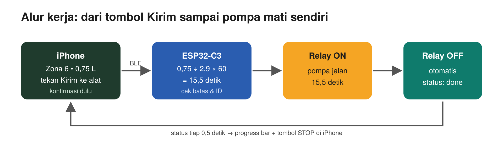
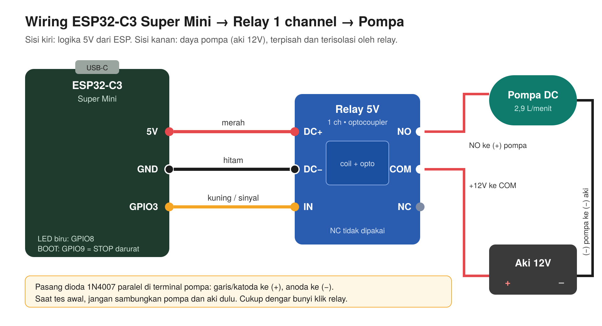

# Tutorial: Alat Penyebar Pupuk (ESP32-C3 + Relay) terhubung ke iOS

Tutorial ini membawa kamu dari komponen di meja sampai menekan **Kirim ke alat** di iPhone dan pompa berhenti sendiri setelah dosisnya tercapai.



**Cara kerja singkat:** petani memilih zona di app, mengisi liter, lalu menekan **Kirim ke alat**. iPhone mengirim perintah lewat Bluetooth (BLE). ESP32-C3 menghitung durasi `liter ÷ debit × 60` detik, menyalakan relay, lalu mematikannya sendiri. Debit pompa saat ini **2,9 L/menit**, jadi 0,75 L ≈ 15,5 detik.

ESP **tidak pernah** menyemprot sendiri. Relay hanya menyala karena perintah eksplisit dari app atau Serial Monitor.

---

## 1. Isi folder

| File | Fungsi |
|---|---|
| `relay_blink/relay_blink.ino` | Tes relay saja, tanpa Bluetooth |
| `spreader_esp32c3/spreader_esp32c3.ino` | Firmware utama: BLE, timer, STOP |
| `spreader_esp32c3/config.h` | Pin, debit default, batas keamanan, UUID BLE |
| `images/` | Gambar tutorial |

Sisi iOS ada di `PalmOilFarmer/Experiments/FertilizerSpreader/`.

## 2. Bahan

| Komponen | Catatan |
|---|---|
| ESP32-C3 Super Mini | + kabel USB-C **data** (bukan hanya kabel charge) |
| Relay 5V 1 channel optocoupler | Pin DC+, DC−, IN, lalu COM, NO, NC |
| 3 kabel jumper | Merah, hitam, kuning disarankan |
| iPhone + Mac dengan Xcode | Bluetooth tidak bisa dites di Simulator |
| Untuk uji pompa: pompa DC, aki 12V, dioda 1N4007, gelas ukur, air bersih | Uji dengan **air** dulu, bukan larutan pupuk |
| Untuk di kebun: buck converter 12V → 5V | Supaya ESP mendapat 5V dari aki |

## 3. Wiring



| ESP32-C3 | Relay | Keterangan |
|---|---|---|
| **5V** | **DC+** | Daya coil relay |
| **GND** | **DC−** | Ground bersama |
| **GPIO3** | **IN** | Sinyal ON/OFF |

| Relay | Pompa / aki | Keterangan |
|---|---|---|
| **COM** | (+) aki 12V | |
| **NO** | (+) pompa | *Normally Open*: pompa mati saat ESP mati atau reset |
| NC | (tidak dipakai) | Jangan pakai NC, karena pompa akan menyala saat ESP mati |
| | (−) pompa → (−) aki | |

Catatan penting:

- Pin **5V** di Super Mini hanya berisi 5V saat board diberi daya lewat USB-C atau lewat pin 5V itu sendiri. Di kebun, sambungkan output buck converter 5V ke pin **5V** dan GND. Jangan ke pin 3V3.
- Pasang dioda 1N4007 **paralel** di terminal pompa: sisi bergaris (katoda) ke (+), sisi lain ke (−). Dioda ini meredam lonjakan tegangan saat pompa dimatikan.
- Untuk langkah 6 sampai 9, **jangan sambungkan pompa dan aki dulu**. Cukup dengarkan klik relay dan lihat LED di modul relay.

## 4. Instal paket board

1. Buka Arduino IDE, lalu **Settings/Preferences**.
2. Pada **Additional Boards Manager URLs**, tambahkan alamat berikut tanpa menghapus alamat lain:

```
https://espressif.github.io/arduino-esp32/package_esp32_index.json
```

3. Buka **Boards Manager**, cari **esp32 by Espressif Systems**. Pakai versi **3.3.x** yang sama dengan proyek CoffeeScaleC3 (3.3.11).
4. **Tidak perlu library tambahan.** BLE dan Preferences sudah termasuk paket ESP32. Kalau kamu pernah memasang *NimBLE-Arduino* atau library BLE lain, tidak perlu dihapus, tapi pastikan sketch ini memakai `#include <BLEDevice.h>` bawaan.
5. Buka `spreader_esp32c3/spreader_esp32c3.ino`. File `config.h` harus tetap berada di folder yang sama. Jangan hanya menyalin file `.ino`.

Petunjuk instalasi board: [Espressif Arduino-ESP32](https://docs.espressif.com/projects/arduino-esp32/en/latest/installing.html).

## 5. Pilih board

| Menu Arduino IDE | Pilihan |
|---|---|
| Board | ESP32C3 Dev Module |
| USB CDC On Boot | **Enabled** |
| Flash Size | 4 MB (cek spesifikasi Super Mini-mu) |
| Partition Scheme | Default 4MB with spiffs |
| Port | Port yang muncul saat ESP32 ditancapkan |
| Serial Monitor | 115200 baud |
| Line ending | Newline atau Both NL & CR |

Jika upload gagal terhubung: tahan **BOOT**, tekan-lepas **RESET**, lalu lepaskan BOOT. Pilih ulang port dan upload lagi. Setelah upload, tekan RESET bila program belum mulai. Prosedur ini berasal dari [dokumentasi resmi ESP32-C3](https://docs.espressif.com/projects/arduino-esp32/en/latest/tutorials/cdc_dfu_flash.html).

## 6. Tes relay (`relay_blink`)

Tujuan langkah ini adalah memastikan relay benar-benar **mati** saat diperintah OFF. ESP32-C3 mengeluarkan sinyal 3,3V, sedangkan relay 5V kadang tidak mau lepas dengan sinyal 3,3V.

1. Wiring sesuai tabel pertama di langkah 3. Pompa dan aki belum disambung.
2. Buka `relay_blink/relay_blink.ino`, klik **Verify**, lalu **Upload**.
3. Buka Serial Monitor. Tulisan `ON` dan `OFF` muncul bergantian setiap 2 detik.
4. Cocokkan dengan relay:

| Yang terjadi | Artinya | Tindakan |
|---|---|---|
| Klik setiap 2 detik, LED relay menyala saat `ON` dan mati saat `OFF` | ✅ Benar | Lanjut ke langkah 7, `config.h` tidak perlu diubah |
| LED relay menyala saat `OFF` dan mati saat `ON` | Relay *active-HIGH* | Di sketch ubah `ACTIVE_LOW = false`, upload ulang |
| Relay menyala terus, tidak pernah lepas | Masalah 3,3V | Ubah `OFF_FLOATING = true`, upload ulang |
| Tidak ada klik sama sekali | Wiring atau daya | Cek 5V→DC+, GND→DC−, GPIO3→IN. Pastikan USB tersambung |

Kalau modulmu punya jumper **HIGH/LOW trigger**, set ke **LOW**.

5. Salin setting yang berhasil ke `spreader_esp32c3/config.h`:
   - `ACTIVE_LOW` di sketch tes = `RELAY_ACTIVE_LOW` di `config.h`
   - `OFF_FLOATING` di sketch tes = `RELAY_OFF_FLOATING` di `config.h`

## 7. Upload firmware utama

1. Buka `spreader_esp32c3/spreader_esp32c3.ino`.
2. Klik **Verify**, lalu **Upload**.
3. Buka Serial Monitor. Akan muncul:

```
Krops spreader 0.1.0 siap sebagai KROPS-SPR-A1B2, debit 2.900 L/menit
{"state":"idle","rate_per_min":2.900,"unit":"L","max_amount":5.000,"fw":"0.1.0"}
```

Catat nama `KROPS-SPR-XXXX`. Empat huruf terakhirnya berbeda di tiap board.

**Arti LED biru di board:**

| LED | Arti |
|---|---|
| Kedip lambat (1 detik) | Menunggu iPhone |
| Menyala terus | iPhone terhubung |
| Kedip cepat | Relay ON, pompa jalan |

## 8. Tes lewat Serial Monitor (tanpa app)

Ketik perintah berikut lalu Enter:

| Ketik | Hasil yang diharapkan |
|---|---|
| `spray 0.5` | Relay ON sekitar 10,3 detik, status `spraying` tiap 0,5 detik, lalu `done` dan relay OFF |
| `spray 0.5` lalu `stop` sebelum selesai | Relay langsung OFF, status `stopped` dengan `amount_est` |
| `spray 0.5` lalu tekan tombol **BOOT** | Relay OFF, status `stopped`, `"reason":"button"` |
| `spray 6` | Status `error` dengan `"code":"OVER_LIMIT"`, relay tetap OFF (batas 5 L per kirim) |
| `status` | Status saat ini |

Tombol **BOOT** adalah STOP darurat. Tombol ini hanya menghentikan semprotan; menekannya saat diam tidak berpengaruh.

## 9. (Opsional) Tes Bluetooth dengan nRF Connect

Langkah ini membuktikan BLE bekerja sebelum melibatkan app kita.

1. Install **nRF Connect for Mobile** di iPhone.
2. **Scan**, lalu cari `KROPS-SPR-XXXX` dan tekan **Connect**.
3. Buka service `4B470001-…`.
4. Pada characteristic `4B470003-…` (status), aktifkan **notify/subscribe**.
5. Pada characteristic `4B470002-…` (command), pilih **write**, format **UTF-8 / Text**, lalu kirim:

```
{"cmd":"spray","id":"tes1","amount":0.3,"unit":"L"}
```

6. Relay ON sekitar 6 detik dan status `spraying` → `done` muncul di nRF Connect.
7. **Disconnect** di nRF Connect sebelum lanjut, karena satu alat hanya melayani satu iPhone sekaligus.

## 10. Jalankan dari app iOS

1. Buka `PalmOilFarmer.xcodeproj` di Xcode.
2. Jalankan test `SpreaderProtocolTests` dan `SpreaderModeTests` (⌘U, atau klik ikon di samping nama test). Semua harus hijau.
3. Eksperimen ini belum menjadi layar utama app. Di `PalmOilFarmerApp.swift`, set `runsExperiment = true` (di bawah `#if DEBUG`).
4. Pilih **iPhone asli** sebagai tujuan Run (bukan Simulator), lalu Run.
5. Di app: tab **Pemupukan** → ketuk kartu kebun. Layar **Mode Pemupukan** langsung terbuka. (Dari peta panduan zona, tombol **Semprot** juga membuka layar yang sama.)
6. Tekan **Hubungkan Alat**. Saat pertama kali, iOS meminta izin Bluetooth; pilih **Izinkan**.
7. Layar berganti ke *Mencari alat pemupuk*, lalu daftar **Pilih alat yang ingin dihubungkan**. Ketuk `Spreader XXXX` (empat huruf terakhir sama dengan nama di Serial Monitor).
8. Setelah terhubung, bagian atas panel menampilkan **KROPS Spreader XXXX** dan LED biru di board menyala terus.
9. **Zona saat ini** hanya mengikuti GPS: terisi saat kamu berada di dalam zona dengan akurasi ±25 m atau lebih baik. Label zona di peta tidak bisa diketuk.
10. Di depan pohon, tekan **Keluarkan Pupuk**. Tombol berubah oranye (**Pupuk Keluar**) dengan lingkar progres; ketuk lagi untuk berhenti. Setelah selesai, penghitung *x dari y pohon* bertambah satu.
11. Kembalikan `runsExperiment` ke `false` di `PalmOilFarmerApp.swift` sebelum commit.

Selama pupuk keluar, tombol kembali dinonaktifkan. Kalau iPhone terputus di tengah semprotan, ESP tetap mematikan pompa sendiri saat waktunya habis.

## 11. Uji dengan pompa dan cek debit

Lakukan dengan **air bersih** dulu.

1. Sambungkan pompa, aki, dan dioda sesuai sisi kanan gambar wiring.
2. Arahkan selang ke gelas ukur.
3. Di Serial Monitor ketik `cal 30`. Pompa menyala tepat 30 detik.
4. Baca volume di gelas ukur, lalu hitung `debit = liter × 2`. Contoh: 1,45 L dalam 30 detik → 2,9 L/menit.
5. Kalau hasilnya berbeda dari 2,9, ketik `rate <debit>`, misalnya `rate 2.75` (pakai titik). Nilai ini tersimpan di ESP, tetap ada setelah dimatikan, dan otomatis dipakai app setelah terhubung.
6. Uji ulang dari app: satu tekan **Keluarkan Pupuk** mengirim dosis satu pohon (contoh saat ini 0,75 L). Pastikan gelas ukur menunjukkan sekitar 0,75 L.

Ulangi pengecekan debit kalau pompa, selang, nozzle, atau kekentalan larutan berubah.

## 12. Pesan error

| Pesan di app | Kode | Penyebab |
|---|---|---|
| Alat masih menyemprot | `BUSY` | Kirim ditekan saat semprotan sebelumnya belum selesai |
| Volume melebihi batas alat | `OVER_LIMIT` | Lebih dari 5 L per kirim, atau lebih dari 3 menit |
| Perintah yang sama sudah dijalankan | `DUPLICATE_ID` | Perintah terkirim dua kali; yang kedua ditolak |
| Satuan dosis tidak cocok | `UNIT_MISMATCH` | App bukan mengirim liter |
| Alat tidak ditemukan | – | ESP mati, terlalu jauh, atau masih terhubung ke iPhone/nRF Connect lain |
| Koneksi ke alat terputus | – | Jarak terlalu jauh atau daya ESP turun |

## 13. Troubleshooting

| Gejala | Coba |
|---|---|
| Port tidak muncul | Ganti kabel USB-C dengan kabel data. Coba port USB lain |
| Upload gagal | Prosedur BOOT + RESET di langkah 5 |
| Serial Monitor kosong | Pastikan **USB CDC On Boot: Enabled**, lalu tekan RESET |
| App terus *Mencari alat…* | Cek LED biru berkedip lambat. Tutup nRF Connect. Matikan dan nyalakan Bluetooth iPhone |
| Relay klik tapi pompa tidak jalan | Cek sisi kanan: aki → COM, NO → pompa (+), pompa (−) → aki (−) |
| Pompa menyala saat ESP baru dinyalakan | Kabel di NC, seharusnya di NO. Atau ulangi langkah 6 |
| ESP restart saat pompa menyala | Daya ESP drop karena pompa. Pakai buck converter terpisah, dan pastikan dioda terpasang |
| Jangkauan pendek | Antena Super Mini kecil. Jangan tutup board dengan logam, dan jaga jarak iPhone dalam beberapa meter |

## 14. Referensi teknis

**Pengaturan di `config.h`:**

| Nama | Default | Arti |
|---|---|---|
| `RELAY_PIN` | 3 | Pin IN relay |
| `RELAY_ACTIVE_LOW` | true | Relay ON saat IN = LOW |
| `RELAY_OFF_FLOATING` | false | OFF dengan melepas pin (untuk masalah 3,3V) |
| `DEFAULT_RATE_PER_MIN` | 2.9 | Debit awal (L/menit) sebelum diubah lewat `rate` |
| `MAX_AMOUNT` | 5.0 | Batas liter per kirim |
| `MAX_DURATION_MS` | 180000 | Batas relay ON (3 menit) |
| `CONTINUE_ON_DISCONNECT` | true | Tetap selesaikan dosis kalau iPhone terputus |

**BLE.** UUID harus sama dengan `SpreaderProtocol.swift`.

| Item | UUID | Properti |
|---|---|---|
| Service | `4B470001-2BFB-437B-A832-BDC71AFCA4E2` | |
| Command | `4B470002-2BFB-437B-A832-BDC71AFCA4E2` | Write |
| Status | `4B470003-2BFB-437B-A832-BDC71AFCA4E2` | Read, Notify |

**Perintah (JSON):**

```json
{"cmd":"spray","id":"z6-mhx3k2a1","amount":0.75,"unit":"L"}
{"cmd":"stop"}
{"cmd":"ping"}
{"cmd":"calibrate","seconds":30}
{"cmd":"set_rate","rate_per_min":2.9,"unit":"L"}
```

**Status (JSON):**

```json
{"state":"idle","rate_per_min":2.900,"unit":"L","max_amount":5.000,"fw":"0.1.0"}
{"state":"spraying","id":"z6-…","target":0.750,"duration_ms":15517,"elapsed_ms":5000,"rate_per_min":2.900,"unit":"L"}
{"state":"done","id":"z6-…","target":0.750,"elapsed_ms":15517,"amount_est":0.750,"unit":"L"}
{"state":"stopped","id":"z6-…","target":0.750,"elapsed_ms":6200,"amount_est":0.300,"unit":"L","reason":"app"}
{"state":"error","code":"BUSY"}
```

`amount_est` adalah perkiraan dari waktu × debit, bukan hasil ukur. Volume sebenarnya bergantung pada debit pompa yang sudah dicek di langkah 11.

**Belum dikerjakan:**
- Dosis otomatis dari *assessment result* (total larutan zona ÷ jumlah pohon). Panel sudah menyediakan parameter `suggestedLiters`.
- Pengecekan debit dari app. Saat ini dilakukan lewat Serial Monitor (`cal`, `rate`).
- Pairing BLE dengan PIN.
